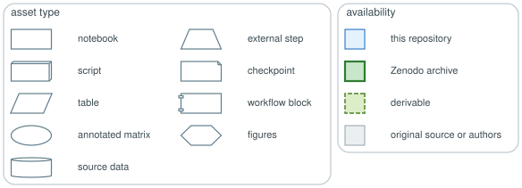

# EMToolbox

A suite of computational tools for studying mesenchymal genes, modules, programs and cell
states in development and cancer. This repository holds the code and figures behind the
manuscript; the data is distributed separately in the
[Zenodo archive](https://doi.org/10.5281/zenodo.24182286).

## Tools

| directory | tool | description |
|---|---|---|
| `mesencoder/` | MesenCoder | conditional autoencoder that generates integrated, low-dimensional embeddings across embryonic EMT (e-EMT) trajectories, resolving full and partial e-EMT programs and cell states |
| `mesencontext/` | MesenContext | context engineering approach that indirectly steers AI agents during their autonomous analyses of Curated Cancer Cell Atlas (3CA) datasets |
| `emtarget/` | EMTarget | antigen discovery pipeline that uses coexpression in e-EMT modules to assemble a candidate vaccine panel targeting these programs and cell states |

## Analyses

| directory | description |
|---|---|
| `development/` | primary e-EMT in three mouse developmental lineages; defines the Gast, pSom, and Crest modules |
| `neuroblastoma/` | co-option of the partial e-EMT program during *in vitro* noradrenergic–mesenchymal transitions |
| `invertebrate/` | co-option of the partial e-EMT program in *Drosophila*, *Hydra oligactis*, and *Mya arenaria* malignancies |

Each directory carries its own `README.md` and a `DAG/` subdirectory.

## Reading the diagrams

`<directory>/DAG/` holds a Graphviz source and render per workflow chain, linking the
repository's code and data assets. Every edge is a read, write, or import. Each node's shape
indicates the type of asset, and its fill color indicates the asset's availability.

## Data and environments

`data/` holds everything the tools and analyses read and write. Source data and derived objects
are documented in [`data/unzip/README.md`](data/unzip/README.md) and
[`README_data.md`](README_data.md), respectively. Each notebook's kernel metadata names the
`envs/` environment in which it was run.
