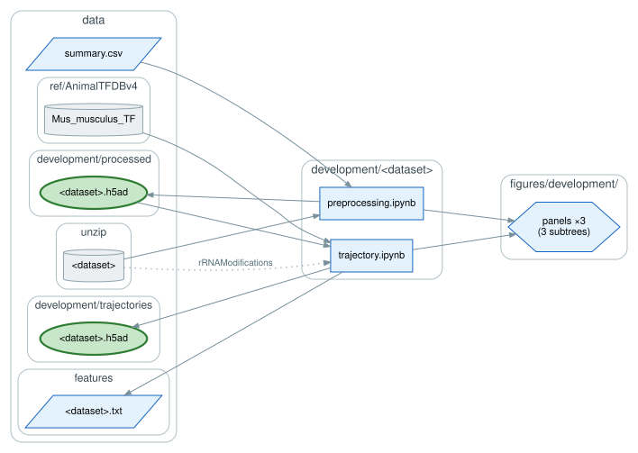
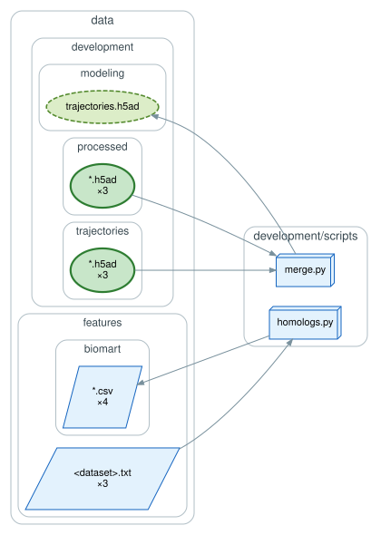
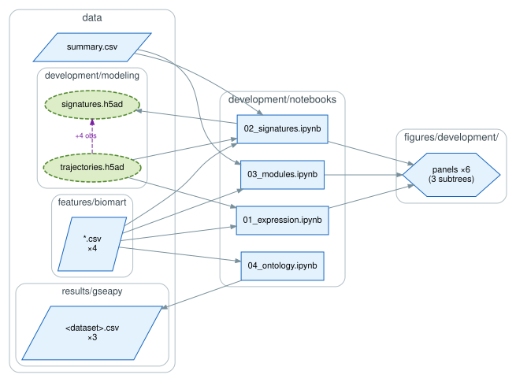

# `development/`: primary e-EMT across developmental lineages

Three mouse scRNA-seq datasets covering primary embryonic EMT (e-EMT), each reduced to a
pseudotime trajectory and then to a conserved gene module. The three modules are what the tools
and the other analyses score.

| directory | lineage | module |
|---|---|---|
| `GSE162534/` | gastrulation | Gast |
| `GSE229103/` | posterior somitogenesis | pSom |
| `rRNAModifications/` | neural crest migration | Crest |

The third directory is named for its source study, not its contents.

## Per dataset

Each dataset directory holds the same pair of notebooks, run in `scFates`
(`rRNAModifications/preprocessing.ipynb` in `scanpy`). `preprocessing.ipynb` does QC,
normalization, integration, and cell-type assignment; `trajectory.ipynb` subsets the
mesenchymal lineage, fits the principal curve, and writes the features significantly associated
with pseudotime.

## Feature homology and merge

`scripts/homologs.py` (`pybiomart`) keeps the features with at least one homolog in both human
and *Drosophila*. That deep-conservation filter defines Gast, pSom, and Crest, and their union,
the control pool used for scoring. `scripts/merge.py` subsets each processed dataset to its
trajectory and concatenates the three. Both run from `development/scripts/`.

## Analysis

`notebooks/` compares the three trajectories: EMT-TF expression across cell types (`01`),
module signatures along pseudotime (`02`, `pygam`), gene-level overlap between modules (`03`),
and GO biological-process enrichment per module (`04`, `gseapy`).

