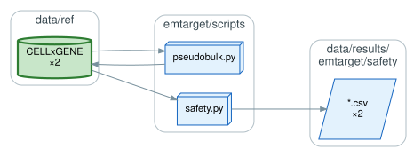
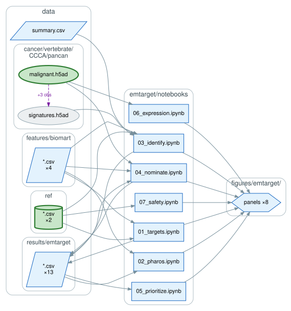

# `emtarget/`: EMTarget

An antigen discovery pipeline that uses coexpression in the e-EMT modules to assemble a
candidate pan-cancer vaccine panel, in three steps that select modules, co-targets, and
antigens.

## Normal-tissue reference

`scripts/pseudobulk.py` reduces the CELLxGENE expression table to a tissue × cell-type
pseudobulk over postembryonic tissues, and `scripts/safety.py` takes the maximum expression per
gene and per gene pair across it.

## Selection

The three steps are `03`, `04`, and `05`. `03` contrasts e-EMT signature enrichment in 3CA
against normal cell types to select the top oncofetal module; `04` nominates co-targets by
gene-pair intratumoral coexpression against maximum normal expression, under a clinically
benchmarked safety threshold; `05` prioritizes antigens over the co-target coexpression network
by evidence tier and unique epitopes in the Immune Epitope Database (IEDB).

`01` and `02` set the premise rather than the panel, measuring how far drug development has
reached the modules' proteins from their Pharos target development levels. `06` reports
expression of the nominated genes across malignant cells, and `07` their normal-tissue safety
margin.
