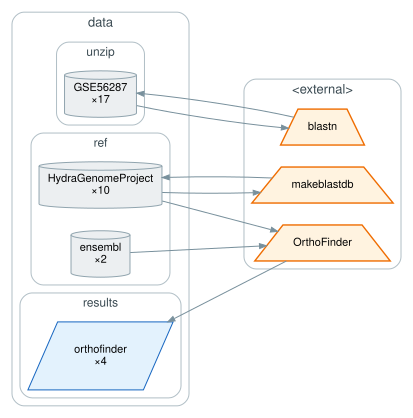
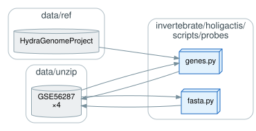
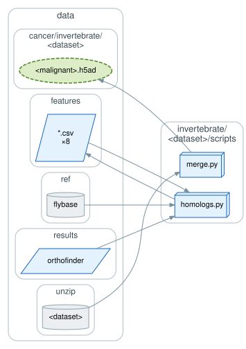
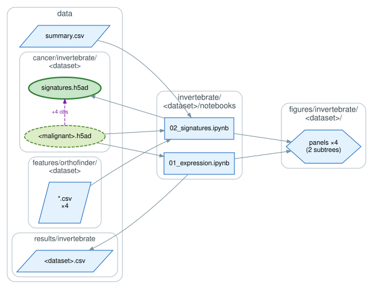
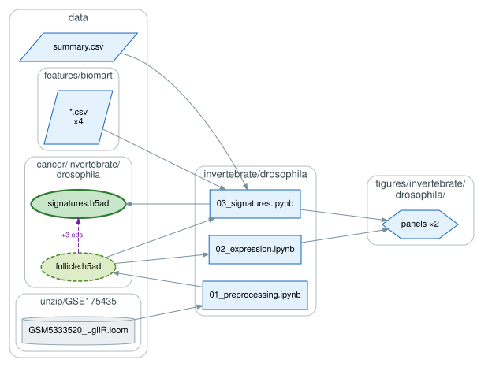

# `invertebrate/`: partial e-EMT in invertebrate malignancies

The e-EMT modules scored in three invertebrate malignancies, to test how deeply the modules are
conserved.

| directory | malignancy | data |
|---|---|---|
| `drosophila/` | *Drosophila* tumor model | single-cell RNA-seq |
| `holigactis/` | naturally occurring tumors in *Hydra oligactis* | expression microarray |
| `marenaria/` | transmissible cancer of the soft-shell clam *Mya arenaria* | bulk RNA-seq |

## Orthology and probe mapping

Module genes reach the non-model species through OrthoFinder, and the *Hydra* expression array
needs its probes placed on the genome first. Neither OrthoFinder nor BLAST is scripted here.

`holigactis/scripts/probes/fasta.py` extracts probe sequences from the platform annotation and
`genes.py` (`pyranges`) assigns the BLAST hits to gene models, both writing back into
`data/unzip/GSE56287/`.

## Per dataset

`<dataset>/scripts/homologs.py` maps the module genes onto each species through the OrthoFinder
orthogroups and the FlyBase identifier table, and `merge.py` builds the expression object from
the source data. `<dataset>/notebooks/` then reports gene expression (`01`) and scores the
modules (`02`).

*Drosophila* differs: being single-cell it carries its own preprocessing notebook, and it takes
its homologs from the Ensembl mapping rather than OrthoFinder.

