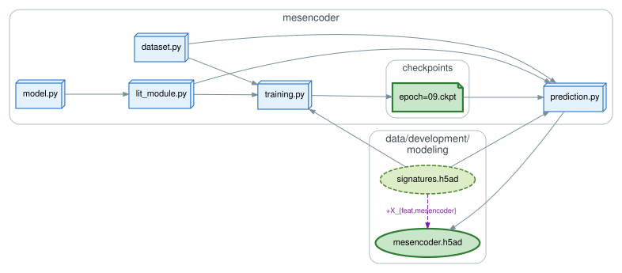
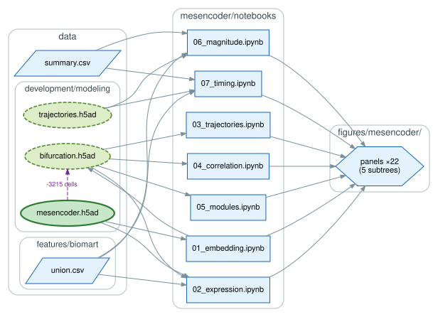

# `mesencoder/`: MesenCoder

A conditional autoencoder that uses the gene expression values from Gast, pSom, and Crest to
generate integrated, low-dimensional embeddings across e-EMT trajectories. Its inferred
bifurcation separates full and partial e-EMT cell states and programs.

## Model and inference

`model.py` is the network: shallow encoder and decoder with one hidden layer each, a
deterministic 2D latent space, and the decoder conditioned on a learned dataset embedding. From
those representations it reconstructs the observed expression values of the 237 genes
comprising the union of the modules. `lit_module.py` wraps it for Lightning and `dataset.py`
supplies the input features; `training.py` and `prediction.py` are command-line entry points
run in `pytorch-clean`.

Gastrulation and posterior somitogenesis train and validate the model on an 80/20 split per
trajectory; neural crest migration is held out for testing. `checkpoints/` holds one checkpoint
per epoch, of which the Zenodo archive carries only `epoch=09.ckpt`, the one that produced the
embedding.

## Analysis

`notebooks/` works through the embedding in order: the integrated latent space (`01`), gene
expression across it (`02`), the principal tree fit to it (`03`, `scFates`), Gast–pSom
cross-module correlation around the branch point (`04`), and the per-gene correlations behind
it (`05`). `06` and `07` compare the magnitude and timing of expression between trajectories,
reading the merged trajectories object rather than the embedding.

