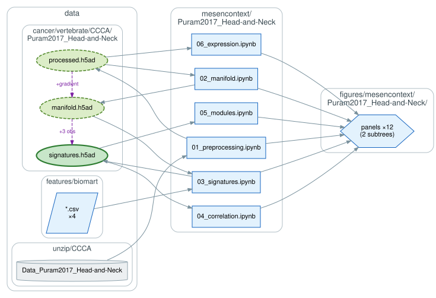
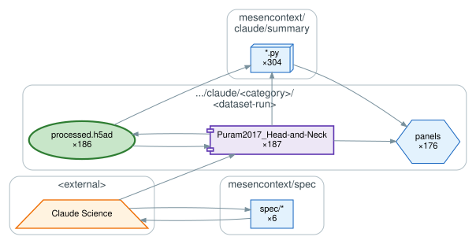
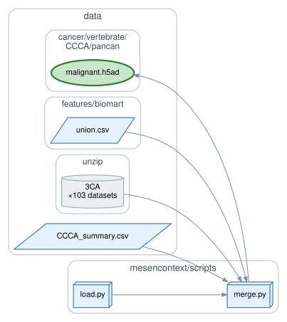
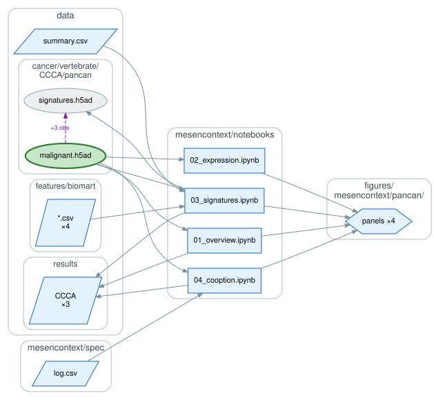

# `mesencontext/`: MesenContext

A context engineering approach that indirectly steers AI agents during their autonomous
analyses of Curated Cancer Cell Atlas (3CA) datasets, to find where malignant cells co-opt
e-EMT programs. A hand-built analysis defines the protocol; natural language encodes it as a
decision tree, and agents re-derive it dataset by dataset.

## The protocol

`Puram2017_Head-and-Neck/` is the reference analysis, built by hand on HNSCC and the source of
truth for the six-step protocol: preprocessing (`01`), manifold (`02`, both `scFates`),
signatures (`03`), correlation (`04`), modules (`05`), and expression (`06`).

## The runs

`spec/` is the task definition, the three GO/NO-GO gates, and the audits behind them, and
`spec/log.csv` is the run ledger. The gates sort a dataset into program co-option, bifurcation
co-option, or no co-option. Nearly every parameter is dataset-dependent, so an agent re-derives
the protocol's judgment calls rather than copying the reference values. The spec is revised
after new autonomous runs, accumulating the context that steers the next one.

`claude/` holds one directory per run under `<Category>/<Dataset>[-N]`, 188 in all, where `-N`
is the run index in the ledger. Objects and panels land under `data/` and `figures/`, and each
run is summarized in a `summary.pdf` built by `claude/summary/`.

## The pan-cancer object

`scripts/merge.py` loads every dataset named in `data/CCCA_summary.csv` through
`scripts/load.py`, keeps malignant cells, and concatenates them on the union gene list.

## Analysis

The pooled object holds malignant cells from across the 3CA datasets. `notebooks/` reports
dataset, sample, and cell counts per disease (`01`), EMT-TF expression (`02`), e-EMT signature
enrichment (`03`), and co-option assessed against the run ledger (`04`).

