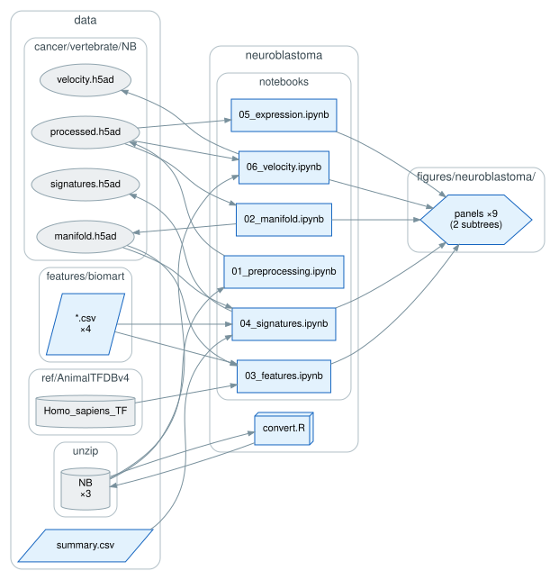

# `neuroblastoma/`: partial e-EMT in a neuroblastoma PDX cell line

scRNA-seq of spontaneous *in vitro* noradrenergic (NOR)–mesenchymal (MES) transitions in an
isogenic, patient-derived xenograft cell line, scored for the e-EMT modules along the
cell-state gradient.

`convert.R` (`seurat`) converts the Seurat object from the original study to `.h5ad` in
place. `notebooks/` then runs preprocessing (`01`), manifold and principal curve (`02`,
`scFates`), feature and signature fits along the gradient (`03`, `04`, both `pygam`), EMT-TF
expression across NOR, MES, and hybrid bridge cells (`05`), and dynamical-model RNA velocity
(`06`, `scvelo`).

The source data is not publicly deposited and none of these objects are in the Zenodo archive;
they are available on request.
